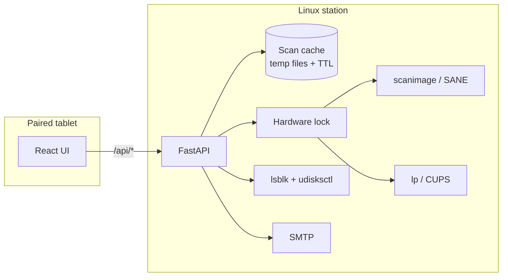

# Kopi — Linux Smart Copier Station

Kopi turns a Linux host connected to a multifunction printer (designed around an HP OfficeJet Pro 9010) into a kiosk-style **copier, scanner and USB printer**. A paired tablet runs a touch-friendly web UI, and a **FastAPI** backend drives the hardware through standard Linux tools.

> **Status:** internal tool / experimental prototype. Not hardened for the open internet. See [Security notes](#security-notes).

## Features

- **Copy** — scan from flatbed or ADF (including duplex), preview and rotate pages, add more pages, then print N copies. Supports HP-style options: color/gray, quality, lighter/darker, content type, resize (actual, fit-to-page, 91%, custom %, 2-on-1), duplex and collate. Defaults are saved on the station.
- **Scan** — to **email** (SMTP), to **USB**, or to a local **archive** folder. Output as PDF, JPG, PNG or TIFF, with optional blank-page removal and custom filenames.
- **ID card scan** — wizard that scans the front and back of an ID, places both on one A4 page, then prints or emails it. Optional OCR through `ocrmypdf`.
- **Print from USB** — browse a flash drive, preview files and print (PDF, JPG, PNG, TIFF, TXT).
- **Tablet pairing** — exactly one tablet is allowed to use the station at a time.
- **Admin panel** — SMTP, scanner and printer selection, pairing PIN, admin password, ID-scan OCR toggle, tablet unpairing.

## Architecture



| Layer | Location | Notes |
|-------|----------|-------|
| Frontend | [`frontend/`](frontend/) | React 18, Vite, React Router, Tailwind. |
| Backend | [`src/kopi/`](src/kopi/) | FastAPI. Also serves the built frontend (`frontend/dist`). |
| Hardware layer | [`src/kopi/hardware/`](src/kopi/hardware/) | Abstract scanner and printer bridges with **Real** and **Mock** implementations, plus one global hardware lock. |
| Processing | [`src/kopi/processing/`](src/kopi/processing/) | Pillow/pypdf/img2pdf helpers: image tweaks, blank pages, ID card layout, mailer. |
| Auth | [`src/kopi/auth/`](src/kopi/auth/) | Tablet pairing and token checks. |
| Tests | [`tests/`](tests/) | pytest, using mock hardware. |

### Hardware modes

`KOPI_HARDWARE_MODE` selects how hardware is handled:

| Value | Behavior |
|-------|----------|
| `real` | Uses `scanimage` (SANE), `lp`/`cancel`/`lpstat` (CUPS), `lsblk` and `udisksctl`. |
| `mock` | No hardware needed. Scans return a synthetic PDF and prints succeed after a short delay. |
| `auto` (default) | `real` on Linux, `mock` elsewhere. |

Note that `auto` picks **real** on any Linux machine, so set `KOPI_HARDWARE_MODE=mock` explicitly on a Linux development VM.

Only one hardware job runs at a time. A second request gets HTTP 409 ("busy").

## Requirements

- **Python 3.11+** and [`uv`](https://docs.astral.sh/uv/). The `.python-version` file pins 3.14, so `uv` may download that interpreter.
- **Node.js 18+** and npm, for the frontend.
- **Real hardware mode only (Linux):** `sane-utils` (`scanimage`), CUPS (`lp`), `udisks2` and `util-linux` (`lsblk`). Optional: `ocrmypdf` for ID-scan OCR. Note that USB flash drive support relies on host `lsblk` and `udisksctl` (`udisks2` over the host D-Bus), so it is not expected to work inside a container yet; printing and network scanning do not depend on it.

## Quick start (mock mode, no hardware)

Works on Debian/Ubuntu, macOS and similar. Run the two parts in separate terminals.

**1. Backend**

```bash
uv sync
KOPI_HARDWARE_MODE=mock uv run kopi
```

The API listens on `http://0.0.0.0:8000`.

**2. Frontend (development server)**

```bash
cd frontend
npm install
npm run dev
```

Open `http://localhost:5173`. Vite proxies `/api` to the backend on port 8000. If you work from another machine, for example a VM, use `http://<vm-ip>:5173`.

Tips for development:

- There are no hardcoded default credentials. On first run, Kopi generates a random 6-digit pairing PIN and 8-digit admin PIN and saves them to `config/settings.json` (mode `0600`). View them with `uv run kopi status --show-secrets`, or set `KOPI_ADMIN_PASSWORD` / `KOPI_PAIRING_PIN` (or their `*_FILE` variants).
- Set `KOPI_REQUIRE_PAIRING=0` to skip pairing while developing.
- Set `KOPI_MOCK_USB_DIR=/path/to/folder` to fake a mounted USB drive.
- Sending email needs a working SMTP server configured in the admin panel, even in mock mode.

## Production-style run

Build the frontend once. The backend then serves it, so a single process on a single port is enough:

```bash
cd frontend && npm install && npm run build && cd ..
uv run kopi
```

Then open `http://<station-host>:8000`. Print a setup sheet for the tablet with:

```bash
uv run kopi print-setup-sheet
```

### CLI

| Command | Purpose |
|---------|---------|
| `uv run kopi` (or `serve`) | Start the server. |
| `uv run kopi status [--show-secrets]` | Show settings path and paired device (pass `--show-secrets` to print the pairing and admin PINs). |
| `uv run kopi unpair` | Release the paired tablet so a new one can claim the station. |
| `uv run kopi print-setup-sheet` | Print tablet setup instructions (URL and PIN). |

## Pairing and access

1. On first run, if no credentials are stored or supplied via environment variables/secret files, Kopi generates a random numeric pairing PIN (6 digits) and admin PIN (8 digits) and persists them to `settings.json` (mode `0600`). Run `uv run kopi status --show-secrets` to inspect them.
2. For headless or containerized deployments, you can supply credentials externally via `KOPI_ADMIN_PASSWORD_FILE` / `KOPI_PAIRING_PIN_FILE` (highest precedence) or `KOPI_ADMIN_PASSWORD` / `KOPI_PAIRING_PIN`. Externally managed secrets are never written to `settings.json` and cannot be modified through the admin API/UI.
3. An unpaired station lets a tablet **claim** it by entering the pairing PIN.
4. The backend issues a random token and stores only its SHA-256 hash. The tablet keeps the token in localStorage and in a long-lived HttpOnly cookie.
5. Copy, scan, ID-scan and USB endpoints only accept the paired tablet's token. Anyone else gets 403.
6. The **admin password** can replace the paired tablet, and the admin panel and `kopi unpair` can release it.

The admin API uses the `X-Admin-Password` header.

## Configuration

Settings live in `config/settings.json` at the repository root (created on first run or save with mode `0600`, gitignored). Override the path with `SETTINGS_PATH`. It holds the stored admin password and pairing PIN (unless externally managed), paired-device info, SMTP settings, scanner and printer selection, copy defaults and the ID-scan OCR flag.

### Environment variables

| Variable | Default | Purpose |
|----------|---------|---------|
| `KOPI_HARDWARE_MODE` | `auto` | `real`, `mock` or `auto`. |
| `PORT` | `8000` | Server port. |
| `KOPI_RELOAD` | `0` | uvicorn auto-reload. Opt in with `1` for local development only. |
| `KOPI_LOG_LEVEL` | `INFO` | Python log level. |
| `SETTINGS_PATH` | `config/settings.json` | Settings file location. |
| `KOPI_ADMIN_PASSWORD` | — | Override admin PIN/password without writing it to `settings.json`. |
| `KOPI_ADMIN_PASSWORD_FILE` | — | Path to a file containing the admin PIN/password (overrides `KOPI_ADMIN_PASSWORD`). |
| `KOPI_PAIRING_PIN` | — | Override tablet pairing PIN without writing it to `settings.json`. |
| `KOPI_PAIRING_PIN_FILE` | — | Path to a file containing the tablet pairing PIN (overrides `KOPI_PAIRING_PIN`). |
| `KOPI_PUBLIC_URL` | — | External station URL (e.g. `http://copier.local:8000`) used by `print-setup-sheet` and added to the CORS allowlist. |
| `KOPI_REQUIRE_PAIRING` | `1` | Set `0` to allow unpaired access. |
| `KOPI_FRONTEND_DIST` | `frontend/dist` | Built frontend directory. |
| `CORS_ORIGINS` | station origin | Comma-separated allowed origins (not needed in normal use since the UI is served from the same origin). |
| `KOPI_SCAN_TTL_SEC` | `300` | How long a scan stays cached before expiry. |
| `KOPI_ID_SCAN_TTL_SEC` | see code | ID-scan session lifetime. |
| `KOPI_ARCHIVE_DIR` | `data/archive` | Where "scan to archive" saves files. |
| `SCAN_DEVICE` | — | Default SANE device, if none is chosen in the admin panel. |
| `SCANIMAGE_EXTRA_ARGS` | — | Extra arguments for `scanimage`. |
| `CUPS_DEST` | — | Default CUPS printer, if none is chosen in the admin panel. |
| `KOPI_SCAN_BUSY_RETRIES` | `4` | Retries when the scanner reports busy. |
| `KOPI_SCAN_BUSY_DELAY_SEC` | `3` | Delay between busy retries. |
| `KOPI_VERBOSE_HARDWARE_ERRORS` | off | Show raw scanner errors in the UI. |
| `KOPI_MOCK_DELAY_SEC` | small | Simulated delay in mock mode. |
| `KOPI_MOCK_USB_DIR` | — | Folder that acts as a fake USB drive. |

## API overview

Interactive docs are available at `/docs` while the server runs.

| Area | Endpoints |
|------|-----------|
| Health | `GET /api/health` |
| Pairing | `GET /api/pair/status`, `POST /api/pair/claim`, `POST /api/pair/replace` |
| Copy | `GET/PUT /api/copy/defaults`, `POST /api/scan`, `GET /api/copy/preview/{scan_id}`, `POST /api/copy/preview/{scan_id}/rotate`, `POST /api/print`, `POST /api/copy`, `POST /api/copy/cancel` |
| Scan | `POST /api/scan/email`, `POST /api/scan/usb`, `POST /api/scan/archive`, `GET /api/scan/usb/drives` |
| ID scan | `POST /api/id-scan/front`, `/back`, `/compose`, `/print`, `/email`, `/discard` |
| USB print | `GET /api/usb/files`, `GET /api/usb/preview`, `POST /api/usb/print`, `POST /api/usb/mount` |
| Hardware | `GET /api/hardware` |
| Admin | `POST /api/admin/verify`, `GET/PUT /api/admin/settings`, `POST /api/admin/unpair` |

## Development

```bash
uv run pytest              # tests (mock hardware)
uv run ruff check .        # lint
uv run mypy src            # strict type checking
cd frontend && npm run build   # type-check and build the UI
```

## Security notes

- SMTP and stored admin/pairing credentials are saved as plain JSON on disk (`settings.json` is written with mode `0600`). Keep the settings file readable by the service user only, or inject credentials via `KOPI_ADMIN_PASSWORD_FILE` / `KOPI_PAIRING_PIN_FILE`.
- Authentication rate limits are global (not per client), so repeated bad attempts from anywhere on the network can temporarily lock admin or pairing attempts; rate-limiter state is held in memory and cleared on restart.
- CORS defaults to the station's own origin (the UI is served from the same origin anyway). Set `CORS_ORIGINS` only if hosting the frontend on a separate origin.
- Pending scans are cached in memory and in temporary files. The cache is single-process and ephemeral, so a restart drops pending scan IDs.
- Intended for a locked-down appliance on a trusted network, **not** for the open internet.

## Repository layout

```
.
├── pyproject.toml          # Python project (uv)
├── src/kopi/
│   ├── main.py             # app factory, CLI entry point
│   ├── config.py           # settings model, atomic JSON persistence
│   ├── api/                # routers: copy, scan, id_scan, usb_print, pairing, admin, hardware
│   ├── auth/               # pairing provider and token dependency
│   ├── hardware/           # scanner, printer, usb, lock (real + mock)
│   └── processing/         # image enhance, pdf, id_card, mailer
├── tests/                  # pytest suite
└── frontend/               # React + Vite + Tailwind kiosk UI
    └── src/{views,components}
```
